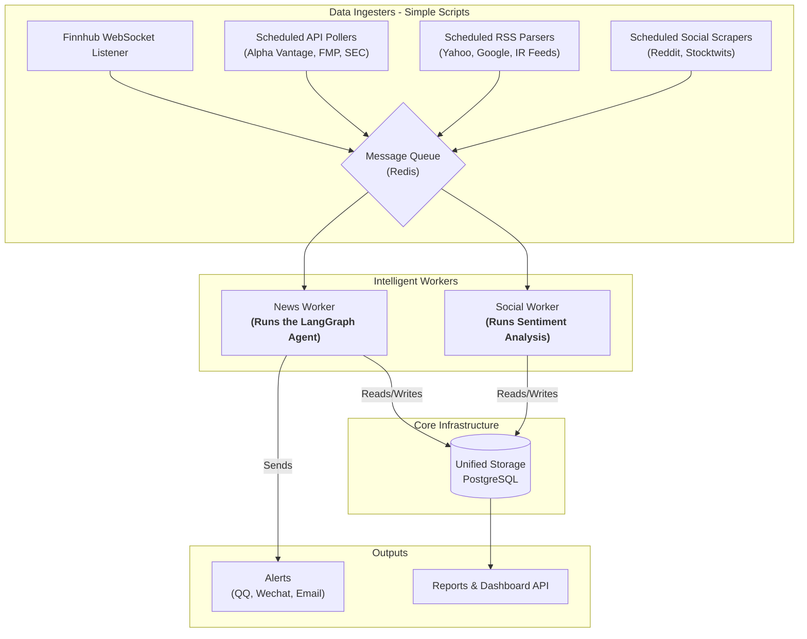

# AI Stock Insight - Design Document

**Implementation status, November 2026.** Local v1 schedules USGS earthquake collection and TSMC disclosure discovery, links evidence to a configurable watchlist, and delivers portfolio-aware terminal alerts alongside a local HTML inbox with coverage warnings. The sections below preserve the original architecture proposal. Recheck source access and pricing before adopting additional feeds. See the [current implementation, demo and tests](README.md).

## Goals
- **Immediate Alerts:** Detect high-impact news events for a configurable watchlist of stock tickers and raise immediate alerts.
- **Actionable Summaries:** Generate concise, human-readable summaries for every alert-worthy item so operators can act quickly.
- **Extensible Ingestion:** Provide an extensible ingestion architecture that can onboard multiple real-time and delayed data sources without major rewrites.
- **Event Consolidation:** Consolidate articles across sources into a unified event view and reconcile conflicting perspectives before alerting.
- **Social Sentiment Briefs:** Produce scheduled social sentiment briefs that highlight trending or favourable tickers from community chatter.
- **Cost-Effective Data:** Rely exclusively on public or free-tier data feeds and browser automation to avoid paid API dependencies. Unless the key is provided.

## The Role of LangGraph: Focused Intelligence
LangGraph excels at building adaptive agent workflows where intermediate results shape subsequent actions. Within AI Stock Insight it should concentrate on the complex, stateful news intelligence loop rather than general orchestration.

- **Core Strength:** LangGraph's graph structure is ideal for the `EventFusion`, `Enrichment`, `BigNewsDetector`, and `Summarizer` stages that benefit from branching logic, shared state, and LLM-backed reasoning.
- **Scoped Application:** Simple ingestion tasks such as polling RSS feeds or pulling an API on a schedule do not need the overhead of a graph. Lean scripts or scheduled jobs are easier to reason about, test, and recover.
- **Implementation Strategy:** Keep LangGraph inside the News Worker where an `ArticleEvent` is evaluated end-to-end. Use traditional scheduling plus a task queue to run the rest of the application.

## Event-Driven Architecture
The system is organized around three pillars: lightweight producers that gather data, a durable message queue that buffers work, and intelligent consumers that process events. This separation keeps ingestion resilient and lets the intelligence layer scale independently.

### Component Breakdown

#### Producers (Data Ingesters)
- **Single Responsibility:** Independent Python scripts handle one source each, normalize payloads into shared `ArticleEvent` or `SocialEvent` envelopes, and push tasks to the queue.
- **Simple Triggers:** Schedulers such as cron, APScheduler, or long-lived WebSocket listeners trigger producers, keeping the logic simple to test and restart.
- **Lightweight Payloads:** Producers add light metadata (source id, ticker candidates, retrieval timestamp) but avoid heavy enrichment to keep ingestion fast.

#### Message Queue
- **Buffering & Resilience:** A durable queue (Redis Queue, Celery, RabbitMQ, or AWS SQS) absorbs spikes in inbound data and shields the consumers if they go offline.
- **Atomic Tasks:** Each task carries the normalized event, source metadata, and retry hints so failed jobs can re-enter the queue cleanly.
- **Observability:** Queue metrics (depth, age, failure rate) drive operational dashboards and autoscaling decisions.

#### Consumers (Intelligent Workers)
- **News Worker:** Pulls `ArticleEvent` tasks and runs the LangGraph agent: dedupe -> fuse -> enrich -> detect -> summarize -> alert.
- **Social Worker:** Processes `SocialEvent` tasks, performing sentiment scoring, velocity calculations, aggregation, and persistence.
- **Scalability:** Multiple worker replicas can run concurrently for elasticity; queue routing keys separate news versus social workloads.

#### Unified Storage (PostgreSQL)
- **Robust Foundation:** PostgreSQL provides robust transactions, JSONB for schemaless event payloads, and analytic queries for backtesting.
- Suggested tables:
  - `events` to store raw article and social payloads plus ingestion metadata.
  - `event_bundles` to capture fused stories, consensus metrics, and dedupe hashes.
  - `signals` to record detector outputs, feature attributions, and LangGraph decisions.
  - `alerts` to log summaries, delivery routes, acknowledgement states, and feedback.
  - `sentiment_snapshots` for daily or weekly aggregated social metrics.
- **Performance Caching:** Redis or an embedded cache supplements the database for dedupe windows, bundle cooldowns, and alert throttling.

#### Outputs and Interfaces
- **Flexible Alerting:** Alerts deliver via Slack, email, or webhooks with controls for throttling, routing, and acknowledgements.
- **Data Access:** Reporting endpoints and internal dashboards read from PostgreSQL to power operator views and scheduled sentiment briefs.
- **Model Improvement:** Historical data supports replay pipelines for evaluation and model tuning.

#### Operations & Resilience
- **Traceability:** Structured logging and tracing across producers, queue, and consumers simplify debugging and incident response.
- **System Health:** Health checks verify queue connectivity, database access, and LangGraph readiness before accepting tasks.
- **Fault Tolerance:** Backoff and dead-letter queues capture problematic events without blocking overall throughput.

## Data Sources

### Tier 1: Free Real-time / Push
- **Press Releases:** Finnhub PR WebSocket (free developer tier) - near real-time press releases and SEC filings; throttled but sufficient for MVP ticker lists. (Python client: https://github.com/Finnhub-Stock-API/finnhub-python)
- **Trade Halts:** Nasdaq Trader Trade Halts feed - machine-readable JSON that flags involuntary halts and regulatory pauses. (HTTP client: https://requests.readthedocs.io/en/latest/)
- **Direct from Source:** Company investor-relations RSS feeds - per-issuer press releases converted to push via self-hosted feed-to-webhook worker. (Parser: https://feedparser.readthedocs.io/en/latest/)

### Tier 2: Free Pull APIs
- **SEC Filings:** SEC EDGAR - JSON filings, exhibits, and 8-K events direct from the SEC. (Library: https://sec-edgar-downloader.readthedocs.io/en/latest/)
- **General News:** Alpha Vantage News & Sentiment - free tier with 100 calls per day delivering tagged headlines. (Library: https://alpha-vantage.readthedocs.io/en/latest/)
- **Headlines API:** Financial Modeling Prep Company News - REST API with free quota covering US equities headlines. (Library: https://github.com/FinancialModelingPrep/fmp-python)

### Tier 3: Free Supplementary / Scraped
- **Broad Coverage:** Yahoo Finance and Google News RSS - broad coverage for secondary confirmation. (Libraries: https://github.com/ranaroussi/yfinance, https://feedparser.readthedocs.io/en/latest/)
- **Scheduled Events:** Public earnings calendars (e.g., EarningsCast, Nasdaq RSS) - schedule context for enrichment. (Parser: https://feedparser.readthedocs.io/en/latest/)
- **Fallback Scraping:** Browser-use automations - controlled scraping of public newsroom pages when RSS is unavailable. (Toolkit: https://github.com/browser-use/browser-use)

### Social Sentiment Feeds
- **Reddit:** API access for subreddits such as r/wallstreetbets, r/stocks for posts and comments. (Library: https://praw.readthedocs.io/en/latest/)
- **Historical Reddit:** Pushshift API for historical search to backfill sentiment baselines. (Python wrapper: https://psaw.readthedocs.io/en/latest/)
- **Stocktwits:** Public API for trending symbols and message streams. (Docs: https://api.stocktwits.com/developers/docs)
- **Search Interest:** Google Trends for search interest in tickers and key phrases. (Library: https://pytrends.readthedocs.io/en/latest/)

## Core Logic Strategies
The News Worker and Social Worker split responsibilities but share common primitives like deduplication, scoring frameworks, and feedback loops. LangGraph powers the nuanced decisions inside the news pipeline while the social worker applies statistical and NLP techniques tuned for velocity.

### Impact Scoring (News Worker)
- **Source Authority:** Percentile rank of the highest-credibility free source in the bundle plus diversity bonuses.
- **Keyword Criticality:** Severity score derived from curated keyword dictionaries and SEC form classifications.
- **Novelty:** Distance from recent bundle embeddings for the ticker, rewarding previously unseen narratives.
- **Market Reaction:** Abnormal return, volatility shift, or order book move measured around the first article timestamp using free intraday data where available.
- **Volume Spike:** Z-score on article velocity for the ticker within a trailing lookback window.
- **Polarized Consensus:** Penalty term reflecting conflicting sentiment or materiality assessments across sources.
- Composite example: `ImpactScore = w_s*SourceAuthority + w_k*KeywordCriticality + w_n*Novelty + w_m*MarketReaction + w_v*VolumeSpike - w_p*PolarizedConsensus`, normalized to 0-100 for alert tiers.

### Big News Detection (News Worker)
- **Rule Engine:** Baseline rule engine with configurable keywords, SEC form types, and source priority weighting gates LangGraph flow decisions.
- **Statistical Checks:** Z-scores on article volume and surprise against historical baselines reinforce the rule layer.
- **LLM Classification:** Optionally introduce an LLM classifier for nuanced tone or materiality once the deterministic features stabilize.
- **Feedback Loop:** Persist analyst feedback (true positives, false positives) to refine thresholds and weights.

### Summarization (News Worker)
- **MVP Approach:** Start with extractive heuristics to guarantee coverage for MVP while tracking quality metrics.
- **LLM Upgrade:** Upgrade to LLM prompt templates that output structured JSON (headline, thesis, quote, next steps) from fused bundles.
- **Aggregation:** Support multi-article aggregation by merging confirmations or disagreements into consolidated digests with consensus notes.
- **Long-form Fallbacks:** Provide fallbacks for long-form filings by targeting specific sections such as Risk Factors or 8-K Item 2.02.

### Social Sentiment Strategy (Social Worker)
- **Initial Models:** Begin with lexicon-based polarity models (VADER, TextBlob), upgrading to fine-tuned transformers when data volume justifies.
- **Velocity Scoring:** Calculate mention velocity z-scores across windows (1h, 24h, 7d) to surface emerging chatter.
- **Engagement Weighting:** Weight engagement via upvotes, comments, Stocktwits reactions, and trend scores to elevate influential posts.
- **Noise Reduction:** Enforce noise controls through author reputation thresholds, post length checks, and platform-specific ban lists.
- **Output Generation:** Generate daily and weekly digests plus ad-hoc briefs when velocity thresholds trigger.
- **Tuning:** Capture analyst annotations (hype, irrelevant, accurate) to tune filters and scoring.

### Alert Delivery
- **Channels:** Default channels include Slack webhooks and email SMTP with markdown formatting and quick actions (acknowledge, snooze).
- **Critical Alerts:** Optional expansion to paging tools (PagerDuty) for critical events.
- **Rich Payloads:** Payloads bundle summary text, impact score, tickers, source links, consensus indicators, and delivery metadata.
- **User Controls:** Maintain per-user or per-team routing rules and throttling to balance noise versus coverage.

## Implementation Roadmap
1. **Phase 0 - Foundations:** Deploy PostgreSQL and Redis, define the `events` table, and wire a single RSS producer that enqueues tasks processed by a minimal consumer writing to the database.
2. **Phase 1 - Detection Loop MVP:** Build the News Worker with an initial LangGraph agent covering normalization, dedupe, simple fusion, heuristic summaries, and Slack alerts; capture feedback for each decision.
3. **Phase 2 - Multi-Source & Summaries:** Add producers for SEC EDGAR, Alpha Vantage, and Financial Modeling Prep; enrich the LangGraph pipeline with better fusion, embeddings, and upgraded LLM summarization.
4. **Phase 3 - Social Sentiment Analytics:** Introduce Reddit and Stocktwits producers, stand up the Social Worker, implement lexicon sentiment scoring, mention velocity anomalies, and store daily snapshots.
5. **Phase 4 - Impact Scoring & Scale:** Calibrate composite impact scoring with historical data, incorporate market reaction signals, harden queue/worker observability, and broaden alert routing rules.
6. **Phase 5 - Advanced Intelligence:** Explore multi-ticker correlations, price impact estimation, and feedback-driven model tuning; expose summaries and sentiment digests through APIs or dashboards for broader consumption.