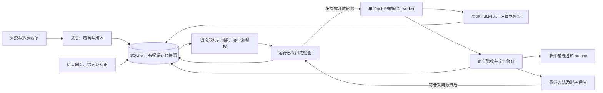

# Stock Insight v0.3 · 持续研究 Harness 架构审阅

2026-11-22 ｜ 设计决定，供实现前审阅 ｜ 实现基线 `codex/stock-insight-i1-i2@ad86b95`

**推荐把常驻执行权留在现有 Python 应用。** 一个调度器把来源检查和到期目标写入 SQLite，一个有界研究 worker 消费需要解释的工作。平常由程序取数、辨认来源修订、更新与新证据有关的检查项。研究产物是可回读证据的案件修订版，也可以附带一个待验证的观察方法。下一次事件复用检查步骤，重新获取属于本次事件的输入。

**最值得先改的三处**是主动监测与提问各自保存案件、宿主保存的历史没有完整进入模型请求，以及新闻修订与普通新闻共用关键词／年龄筛选。解决这三处，比更换 agent 框架更直接地决定能否少做重复调查、少漏重要变化。日常运行默认出站，公共原始来源优先，Fiscal REST 承担已验证权益内的结构化取数。保留现有助手连接作为可选执行入口。默认新增付费额度为零。

**现状有边界。** 指定分支已有前台监测、证据版本、财务计算、有界工具循环、租约、案件修订及独立通知尝试。统一案件、可执行的方法采用、局部失效、跨入口用量账和 Fiscal 新闻／日历是本次设计。隔离测试及一次截获模型首包的实验支持下列判断。个人账户的新闻覆盖、盘后行情、历史 Street 和无人值守模型执行均未在本轮实证。先读 §2 的代码映射，沿 §3–4 看一次运行，再用 §7 的场景检验取舍。

## 1. 审阅基线和设计选择

| 证据身份 | 本文的用法 |
|---|---|
| **已实现** | 在本地指定分支的实际工作树读取代码，可用下表中的路径与符号复查。 |
| **隔离验证** | 本轮在临时 SQLite、历史包、合成输入或模拟传输上执行过，结果和限制见 §9。 |
| **文档意图／历史记录** | v3 要求的预算、时间和研究契约，或以前操作者记录的运行。历史实测保留原条件。 |
| **拟议／待核实** | 下文的 v0.3 行为、阈值及新字段均为设计决定。外部合同、运行环境或效果需要另行实测的地方标为待核实。 |

交付工作区 `E:/Project/ai-stock-insight` 的 `main` 是 `794237f1153a364d882badc8cad1edb129816b10`，含用户提供的未跟踪 `docs/`。实现代码在同一仓库已有工作树 `E:/OpenAI/ChatGPTDesktop/worktrees/2541/ai-stock-insight`，HEAD 为 `ad86b95b7e71cdb81554a0684bbc43811de01a84`，与 03 的快照及本地对应远程跟踪引用相同。下文所有代码路径相对此实现树。该树已有改动的示例 watchlist 和两份未跟踪实施评审。两处都保留原状，本文件写在前一处。核对了两树项目说明及实现树 README，未发现适用的仓库 `AGENTS.md` 或 `RULES.md`。[实现树快照](https://github.com/Freedom-Jack/ai-stock-insight/tree/ad86b95b7e71cdb81554a0684bbc43811de01a84)

v3 已提出站立目标、材料到达后重开问题、方法修订、主动议程和决策回顾。这次增加的是它们之间可执行、可测量的衔接。继续执行单机单调度所有者、凭证由宿主持有、监管来源时间可溯、个人名单只读和无交易的规则。旧 Stockwatch 中改变运营状况判断所需的人工复核仍适用。角色限定为研究的 worker 只能建议开发能力。旧施工顺序不改变本轮设计审阅范围。[产品](../stock-insight-v3/design/PRODUCT.md) · [研究工作流 §§5、9–11](../stock-insight-v3/design/AGENT_WORKFLOWS.md) · [v3 决定 D02–D15](../stock-insight-v3/delivery/DECISIONS_AND_OPEN_ITEMS.md)

**执行器选择。** 采用现有 `research` 的案件、读取凭证与提交契约。对已授权自动深研，首选宿主控制工具的 `executor.py` 出站 Responses 适配器，启用条件为项目显式配置可用模型、用途、额度与计费。其请求逐步可控，宿主可在任何有成本的下一步前停止。本地确定性计算平常可用。缺少可用推理执行器时，先保存观察和可交付的局部结果，把开放问题排为待处理。已有设备分类器可以作为经 eval 选用的便宜分类器。其输出是一个焦点选择。

**实质备选是把整项研究交给已连接的 Desktop／Work 助手。** 沿用 `assistant_mcp` 的领取、只读证据、计算、提交和事件通知，模型自己编排步骤。它适合有人在线追问、希望沿用现有订阅的情形。无人值守唤醒、真实模型用量和限额可见性会成为依赖。历史交接已为 Work/dot 指定私有云连接。已有目标若指定这个执行方，继续服从原授权。改用付费 API 须有单独授权。以往实现记录是在活跃 Desktop 对话中完成的。只有在关闭对话也能按时领取、过期可恢复、额外费用能封顶、仍可回读同样证据时，才考虑把它调成常驻首选。同一任务绑定一种执行方式，切换要重新取得租约和授权。v3 偏好的本地 Codex CLI 在本树 `codex_worker.probe` 只查账户及限额，无法据此选作无人值守工人。[历史运行与未核实的连接](https://github.com/Freedom-Jack/ai-stock-insight/blob/ad86b95b7e71cdb81554a0684bbc43811de01a84/docs/implementation-status.md)

在这个负载下，一个 SQLite 状态机已有比引入 LangGraph 更便宜的恢复点。Pi 会增加第二种语言运行时，Dexter 的内部 Agent 还会增加版本耦合，DSA 的分析端点可能另调模型并发出通知。这些均不进入推荐运行链。若将来本地宿主确实无法控制取消、工具协议或上下文长度，先按同一批案件替换**一个 worker**比较质量、总调用和维护，再决定依赖。对照项目及许可线索沿用任务书附录 A。[02 附录 A](../stock-insight-design-guide-v0.3/02-architecture-codex-technical-zh.md)

## 2. 一台机器上的控制流和代码归属



**物理拓扑（拟议）。** 沿用 `python -m stockinsight serve`、FastAPI 本地界面与 `ownership.scheduler` 的 OS 锁。前台 tick 只领取短工作、检查截止和交付。一个后台研究线程有独立 SQLite 连接，负责耗时工具和模型 I/O。采集按来源的有界工作单元运行，慢来源在单独的限并发 I/O 槽中执行。事务只用于领取或提交，不跨网络等待。试用时随应用退出，休眠记漏跑。单节点服务器可由现有服务配置监督同一应用。增加 worker 并发、队列服务和公开入站都没有当前负载证据。服务器上线还依赖真实外部健康观察、备份恢复与送达验证。

| 责任 | 已实现的入口与限制 | v0.3 的落点与所有者（拟议） |
|---|---|---|
| 入口、时钟与名单 | `web.application` 在 lifespan 启动 `monitor.run_foreground`。live 串行轮询 delivery、monitor、proactive、assistant_events、memory、agenda。历史 replay 有单独分支。UI 的研究动作会执行 `research.run_job`。`universe.import_snapshot` 管理成员与候选。 | UI 的提问、追问和 goal 都写可持久领取的工作，立即返回 case/job 链接，长任务移出 tick 与 HTTP 请求。IBKR 管名单成员，本地管 pin、主题、有效期内的暴露关系与研究史。 |
| 采集与来源健康 | `monitor.configure/tick`、`goals.reconcile_sources/coverage`、`evidence.claim_public/capture_public`、`events.append_event/at_commit` 已有计划槽、请求回执、证据与事件版。区间内最近一条成功回执不足以证明整窗完整。 | 扩展这些记录，追加查询范围、分页完成、最后成功水位和缺口。增加 `fiscal_data.py` 薄适配器。全局 Fed／BLS 发布先收一次，按有效主题／暴露投影给各目标。 |
| 路由与观察 | `proactive._decision/_discover/_claim/_run` 处理词表、修订、日限额和到期工作。有设备模型时 `_run` 可能先选 focus。`methods.event_report` 按请求键重放整份报告。 | 保留 goal、决策理由与去重键。拆出 `observation.py` 的适用性、单项检查、依赖和局部失效。把常规 focus 改为已采用方法的显式输入。决定开深研前先看观察结果。 |
| 案件、证据与研究 worker | `research.ask/claim/submit`、`bridge.Bridge`、`assessment.render` 有 `cases/jobs/runs/briefs`、read-set、版本冲突和收件箱。`assistant.enqueue/accept` 另存 `assistant_jobs`、reads、calculations 和结果。`proactive` 还会写 `method_reports`、`goal_dispatch.body`。 | 以 `cases` 下一版 `briefs` 为新研究的唯一验收结果。`goal_dispatch` 留工作状态和结果引用，`method_reports` 留计算／观察输入。将 `assistant_mcp` 与 Responses 都接到同一领域验收，助手保留 scoped MCP 门面及投递回执。 |
| 记忆、方法与反馈 | `memory.recall/attachments/dependencies/tick`、`claim_evidence` 已关联部分新证据与旧断言。扫描主要依赖同 origin、URL 的后续版本。`journal` 记用户理由，`gaps` 记能力缺口。`agenda.action/_suggest` 和 `agenda_method_versions` 已有提议、采用、拒绝、退役及原因。 | 在已有记录上追加方法适用范围和受限步骤，见 §6。统一索引保留事实、解释、反证、待办、用户决定这几种来源身份。按旧版引用与输入语义查影响范围。 |
| 时点、预算及交付 | `db.write` 用 `BEGIN IMMEDIATE` 并分配 commit 序号，当前有 11 次带校验的迁移。`delivery.enqueue/tick` 的发送尝试独立于报告，`assistant_events` 的唤醒回执也独立。 | 追加迁移存工作引用、授权版本、用量预留、覆盖、依赖和方法运行结果。`delivery` 继续独占外发。UI 展示预计／实查、安静／缺口、报告版本、投递与阅读。eval 从同一日志取样。 |

兼容路线是先让新工作引用一个 `case_id/base_revision`。保存 `(旧入口类型, 旧case/job/report ID) → (case, revision或观察ID)` 的唯一映射，经同一验收函数写入正文和一次交付意图。旧报告按原 manifest 可读，旧 URL 仍可查历史，导入记录保留原始 ID 和来源。无法证明同案时显式关联为相关问题。先在数据库副本上反复执行迁移、查重复通知和回读旧链接，之后才切换新写入。每次提交比较领取时的案件版、目标是否仍有效、事件是否已被取代及租约 generation。遇到并发修订保留 reconciliation draft，按新材料重开受影响部分。[案件与提交](https://github.com/Freedom-Jack/ai-stock-insight/blob/ad86b95b7e71cdb81554a0684bbc43811de01a84/stockinsight/research.py) · [主动派工](https://github.com/Freedom-Jack/ai-stock-insight/blob/ad86b95b7e71cdb81554a0684bbc43811de01a84/stockinsight/proactive.py) · [助手接纳](https://github.com/Freedom-Jack/ai-stock-insight/blob/ad86b95b7e71cdb81554a0684bbc43811de01a84/stockinsight/assistant.py)

## 3. Harness 在哪一步决定继续、升级或停止

以下为拟议伪代码。采集工作的单位是“一个来源、一个身份或批次、一段待覆盖的窗口”。观察的单位是“一个目标下的问题及其输入版本”。多个目标可以共享采集回执。用户提问直接进入目标范围与预算检查，允许一次性调查。

```python
def on_page(receipt):
    staged = verify_and_stage_permitted_bytes(receipt)
    with transaction():
        changes = save_versions_and_coverage(receipt, staged)
        enqueue_unrouted_versions_once(changes)
        advance_contiguous_complete_watermark()

def route_pending(change):                  # 有租约，可在重启后重放
    dirty = mark_affected_checks_and_claims_once(change)
    for goal in eligible_goals_and_bounded_discovery(change, dirty):
        if already_decided(goal.version, change.version, dirty):
            continue
        method = applicable_adopted_method(goal, change)
        obs = observe_or_mark_uncovered(method, change, dirty)
        decision = route(goal, change, obs, time_left(), remaining_budget())
        commit_decision_and_next_action_once(decision)
    acknowledge_after_all_goals(change)
```

| 优先判断 | 确定的下一步 | 停止或重开依据 |
|---|---|---|
| 身份不明、授权已撤、来源故障或分页未完 | 停相应取数并记失败、重试或权益缺口。已提交页中有可引用的新公告仍可处理，并显式标区间不完整。 | 恢复窗口、权限或身份确认后唤醒。到报告期限可用现有证据交付 partial。 |
| 数据重复、来源仅转载、输入语义未变 | 追加来源／覆盖回执。同一发布的多个链接归同一原始来源族。只改排版不触发新推断。 | 0 次模型调用。新版本改变数字、限定语或适用范围才使关联检查过期。 |
| 范围内、方法适用、可确定判断 | 执行缺少的检查。无重要变化就安静记录，有值得提示的事实按偏好交付有限初判。 | 下一次事件、独立信息到达、资料到期或用户追问。仅缺一个能取的输入则单独补取。 |
| 明确反证、失效条件、重要矛盾或开放问题 | 预授权内创建／合并深研任务。临近截止先交付带证据的局部结论，再登记后续。 | 资料未发布、数据包无权或窗口尚未结束时等待具体触发。超范围、需新增费用或改长期频率时显示需要决定的差额。 |
| 新主题无方法或相关性含糊 | 对原始公告、已知重大事件和已引用材料的修订有直接入口。余下按暴露、目标和信号强度分流。留发现额度，词表未命中仍可选入深研或抽查。 | 一次可选的短分类只能给“相关／无关／不确定”及理由。不确定且可能影响现有假设时保留待查。抽查权重见 §8。 |

观察函数遇到无适用方法直接返回“未覆盖”，交给发现分支。对于适用方法，它先验证目标版本、数据权限和时点，尽量在本地重算。每一个需要出站的步骤先经 §8.1 的原子预留。被拒绝的步骤返回具体缺口，仍可分流其他已完成的观察。调度器只在所有目标的处置已落库后确认消费。一次处理到一半崩溃，下次沿同一事件版与目标键接续。

**为何调整顺序。** 现有 `proactive._decision` 对 occurred 的七天界限和目标词命中早于 `supersedes` 检查。把修订关联到旧断言的工作放在年龄过滤之前，“今天收到旧事件的更正”影响今天持有的结论。失效只标注旧断言截至哪个版本可用，不追改历史简报。粗筛若只用正则，低成本但会漏掉没有熟悉词语的新风险。基于历史分布的异常值适合数值／价格筛查，样本少、口径改变时退出。需要解释含糊标题、跨公司影响或相互矛盾的叙述时，才为语义判断分配模型。冷启动阶段以规则＋保留原条目及抽样作基线，影子评估优于基线后再启用短分类。

```python
def investigate(job):
    lease, ctx = claim_and_freeze_base(job)
    for turn in bounded_turns(job, reserve_final_turn=True):
        if expired_or_superseded(lease, ctx):
            return close_attempt_and_reconcile()
        if no_affordable_step() or deadline_near() or repeated_without_new_evidence():
            break
        packet = ctx.pack_assignment_and_recent_steps()  # 宿主增量维护，单次请求仍自足
        action = metered_model_call(packet, allowed_tools(), final_only=turn.is_last)
        if action.submits:
            return host_validate_and_commit(action, scoped_receipts(), lease)
        result = reuse_or_execute_allowed_tool(action, ctx, lease)
        ctx.append_reference(result)         # 文档只追加可定位、可回读的摘要
    return host_close_with_supported_facts_or_gap(job)  # 记录未验收草稿或 partial
```

每轮只能选择一次在册操作。问题已有充分依据，且已考虑重要反证或替代解释时可提前提交。相同参数和输入版本再次出现先返回已有结果引用。若连续两步既未新增证据，也未缩小缺口或改变解释，就收束。预算、墙钟、取消、目标撤销、旧事件被取代是宿主硬停。最后一轮只许提交。已无模型额度时程序根据已验证事实生成 partial，最低证据也不足则 blocked。验收要通过当前 scope、时点、精确段落、计算输入、版本和授权校验。引用错误最多在剩余额度内给一次具体修正机会。无预算、证据或有效租约就留下原因。模型自报“已查”不能满足工具凭证要求。

## 4. 上下文、工具和三种复用

| 调用 | 首包中真正需要的信息（拟议） | 可操作范围与产物 |
|---|---|---|
| 常规采集、安静监测、财务计算、交付和重试 | 均为程序逻辑，无模型首包。 | 确定性 REST / SDK、数值比较／窗口、覆盖与 outbox。 |
| 可选的语义分流 | 一条去重后的变化、发布者／时间精度、目标摘要、已证暴露或受影响问题、分类定义。 | 一次短请求，零工具。输出类别、对应证据 ID、不确定性。无可用模型时保留规则和发现队列。 |
| 有界深研（含一次性提问） | 问题、listing 与公司、约束／剩余时间和预算、信息策略、base revision、方法版本、已完成检查、变更、自上次确认的判断与反证、仍缺什么。附少量带身份的段落索引、限定语、可用工具及已知权益。 | 先按索引读原文，再按需查下一页、补一个允许的数据集、计算，或记录缺口与建议。输出事实／计算引用、条件解释、最强反证、未决问题、下一触发。 |
| 提炼候选方法 | 优先在深研提交中顺带给出候选。仅较复杂的纠正另开一次短请求，给旧方法、反例、修订原因、可用步骤和采用政策。 | 零外部工具，产出草案。由程序验结构、回放再按政策采用。结构化偏好、停用操作及同一纠正的重放不调模型。 |

在 `research.claim` 基础上显式生成一份有字段白名单的 context。保留宿主对私密性和截止时间的过滤，把 `source_updates`、`dependencies` 和可见 `prior_research` 投影成少量有归属的差异。对 live 问题按证券、案件与有效期检索。旧用户观点带作者及日期。固定截止时 `memory.recall` 目前排除缺少历史版本证明的私人进口记录。长篇材料存于有权保留的快照／段落索引，模型只按 ID 展开，宿主对 locator、版本 hash、段落本身与重要限定语复核。原文与供应商摘要作为研究数据处理。每步保留动作、参数摘要、可观察结果和费用，不依赖私有思考轨迹恢复。[Bridge](https://github.com/Freedom-Jack/ai-stock-insight/blob/ad86b95b7e71cdb81554a0684bbc43811de01a84/stockinsight/bridge.py) · [Responses 首包与工具循环](https://github.com/Freedom-Jack/ai-stock-insight/blob/ad86b95b7e71cdb81554a0684bbc43811de01a84/stockinsight/executor.py)

工具目录取“此 job 允许的动作 ∩ 已验证能力 ∩ 此身份和时点可读数据”。保留 `search_evidence/next_evidence_page/get_evidence`、`compare_financials`、`price_context` 和 `record_gap`。增加按 §5 定义的少数语义工具。续页沿一次搜索的 commit 水位。材料变化时显式发起新搜索。隐藏不可用采集动作，直接给已有缺口及可重试条件。宿主将 `assessment.render` 的类型化数值与 `assistant.accept` 的 hypothesis、alternative、next check 合入同一验收。叙述可以有多种合理解释，事实与数字仍须能回到本 run 的读／算凭证。仅凭结果字段名 `sources` 不提升证据等级。

| 要省的工作 | 复用条件 | 必须刷新 |
|---|---|---|
| 同一结果的重复请求或计算 | 工具语义版本、规范化参数、主体、授权与保留范围、信息策略、输入版、feed／口径都匹配。动态查询还需覆盖窗口和新鲜度。记录来源回执与本次 cache hit。跨任务须重新检查资格并签发本任务的读／算凭证。 | TTL 到期、新闻修订、重述、解析版本、币种／复权／期间或权限变化时重新核验。已确认的数据包拒绝待授权变更再探。公共来源或原因未明的 403 标暂不可用，检查访问要求并有限冷却。429 等到冷却结束，空结果只在覆盖窗口内有效。 |
| 跨事件沿用方法 | 复用同一版“哪些指标、怎样比较、何时升级”，可复用有有效期的背景及其依赖。给每个检查保存用过的 `passage/version`、参数和代码版。 | 新季度的 actual、指引、预期快照及当期价格各有新输入。某项修订只使依赖它的观察与断言失效。 |
| 便宜筛选 | 用较小的证据集和已校验规则，得到有范围的观察／不确定。保存被跳过者及理由。 | 遇到限定语、异常窗口、方法不适用或命中抽样需再读原文。近似值不冒充完整调查。 |

当前 Responses 请求设置 `store: false`。拟议首包及后续包都包含稳定任务约束、已确认事实／检查点、当前差异和最近的必需调用项及对应结果，保留该协议要求的关联 ID 与 reasoning items。宿主在本地增量维护这份上下文。每次请求按实际发送大小计费和限长。进程重启可从已持久化的证据及凭证重建任务包。

对同一在途请求，宿主按规范化键只允许一方出站，其余订阅同一结果。身份不相容的任务分别读取。缓存命中、重新验证、真实 wire 调用分别计数。外部契约只允许链接／摘录时，保存受许可的定位、摘要、校验与权利状态。将已不可回读的依据标注在案，避免声称完成可复算验证。

## 5. 数据接到哪里，能回答多精确的问题

**选择。** 公告原文用发行人／SEC，宏观政策沿用 Fed、BLS、CMA。公司新闻、earnings 日历与财务数据优先 Fiscal REST。专业 MCP 只给开放研究按需调用。价格先满足明确的常规收盘问题。只有具体任务要求盘后且已核实行情权益时接 Alpaca Data。名单先走现有完整文件导入。以下规范版本和路由采用 03 在 2026-11-22 核对的公开资料，Fiscal OpenAPI 摘要指纹为 `c0cf7401…617bfec0a6`。这是一套接入决定，账号实测见 §9。[03 接入目录及官方依据](../stock-insight-design-guide-v0.3/03-interface-reuse-catalog.md)

| 数据与复用入口 | 宿主适配、时间／分页与降级 |
|---|---|
| **发行人、SEC 与宏观。** 沿用 `issuer_news.rows/observe` 的 NVIDIA `/cats/press_release.xml`、`filing_passages.select` 的 `data.sec.gov/submissions/CIK<10位>.json` 及 `evidence` 的 SEC companyconcept。沿用 `sources_calendar` 的 FOMC、BLS CPI／就业、CMA 公告和已指定的 MSFT 入口。 | 发行人 RSS 目前取前 40 项元数据。源滚动致断档就记未知。SEC 按 accession、form、原始文件和合格披露时点处理，现实现从最近 250 条挑一份合格 8-K/8-K/A 并抽有限段落。扩展为按窗口枚举、按 `filings.files` 回补历史。结构化财务必要时取 `api/xbrl/companyfacts/CIK….json`。SEC 要真实联系用 User-Agent，维持项目的主机节流。复用 `sources_calendar.observe` 的修订处理。日历到点只触发查结果。政策决定或发行人运营影响需另有原文。 |
| **Fiscal 身份及授权。** REST 基址 `https://api.fiscal.ai`，项目 included 开关与 `X-Api-Key`。`GET /v3/company/profile?companyKey=NASDAQ_NVDA`，已有 probe 使用 ticker + exchange。 | 保存 `companyFiscalIdentifier → company_id`，按 security 与 `listingFiscalIdentifier`、交易所、币种关联本地 instrument。现有 NVDA/MSFT probe 只校对 CIK、ticker、主上市地，未保存这些 Fiscal ID。公司查询的 `fscl` 取公司标识。行情响应还须匹配所选 listing。ADR、次级上市或企业行动后无法确认就暂停该价格路径。 |
| **公司新闻。** `GET /v1/company/news?fscl=<公司>&startDate=…&endDate=…`，必要时用 `/v1/top-news` 做有限发现。 | 公司新闻按含首尾 UTC 日期分窗，每窗 ≤31 天，03 未见该端点分页或稳定文章 ID。高频时重复查当前日并重叠前一日。离线按可查区间拆窗。top-news 最长 7 天，用 `pageNumber/pageSize` 跑完分页并记录市值过滤。保留低 importance 与未路由条目。按原发者、文章标识／可辨识链接建立条目标识。共用列表 URL 时用主体、原标题、可证日期等建候选簇，近似相同只标候选关联，改名且身份不明保留两条待核。对稳定条目标识另算内容版。UTC 文件日期、`collectedAt`、有证据的原文发布时间及本机收到时间分列。 |
| **财报日历、指引资料和转录。** `/v1/events-calendar?fscl=<公司列表>&startDate=…&endDate=…&page=1&pageSize=100`。`/v1/company/ir-events?fscl=…`。 | 用 `meta` 决定下一页。`eventId` 标识事件，`eventGroupId` 关联 release/call，保留角色、状态、dateWindow 和精确度。同事件改期撤销旧 due、更新观察，estimated 日期不能生成伪精确时刻。选择 `resourceType=transcript` 的 `resourceId` 调 `/v1/company/ir-events/transcript/{eventKey}?fscl=…`。尚未发布则登记待到达资料。 |
| **财务、KPI 与预期。** `/v1/company/financials/{statementType}/standardized` 或 `as-reported`、`/v2/company/segments-and-kpis` 传 `fscl,periodType=quarterly`。Street 用 `/v1/company/estimates/street?fscl=…&history=true`，Agentic 用 `/v1/company/estimates?fscl=…&includeReportedPeriods=true`。 | 保留来源单元格、期间起止、单季／YTD、GAAP／调整口径、币种、单位、重述与可得时间。映射到 `evidence` 类型化观察、`methods.freeze_expectation`。指引、Street、Agentic、用户情景分别标注。Street 样本说明与个人 non-commercial 套餐排除同时存在。无数据包则使用指引与前向留存的合规快照。仅有某日历史共识时，同日盘中公告之前是否可得仍未知。 |
| **行情。** 常规收盘优先 `/v3/company/stock-prices?fscl=…&startDate=…&endDate=…` 或现有合格价格文件。 | `methods.import_prices/price_window` 与 `price_research` 核对两端 listing、session、收盘定义、复权及 vintage、币种和延迟。Fiscal 的日内 `/v1/company/stock-prices/intraday` 目前缺时区、延迟、盘前盘后覆盖证明，不能直接喂现有收盘类型。确需盘后则新增独立 bar 类型，首选 Alpaca `GET /v2/stocks/bars`，传 symbols、1Min、时间窗、feed、adjustment 并跟完 `next_page_token`。仅在权益成立时选 SIP，IEX 标单交易所。保留 DST、早收盘、缺 bar、修订单和基准同窗口，未覆盖时仅输出可验证的常规时段。 |
| **名单。** `universe.import_snapshot` 继续接已选择列表的完整文件。条件满足才接 `GET /iserver/watchlist?id=<选定ID>`。 | IBKR 决定该列表的成员关系，本地按 conid 等解析选定 instrument。接 API 要扩展允许的来源／transport，验证列表 ID、完整性及版本，候选通过后才应用移除。空／部分身份、超时、会话失效保留最后一次完整名单并显示陈旧程度。枚举 `/iserver/watchlists` 与 `/iserver/watchlist?SC=USER_WATCHLIST` 的文档冲突留给真实只读会话核验。只采用已选 ID 时可绕开枚举依赖。 |

**MCP 的具体边界。** `providers.discover_fiscal/_mcp_catalog` 已能以 Bearer key 初始化 Streamable HTTP 并取第一页工具，遇 `nextCursor` 标为 partial。当前没有通用调用桥。拟议接在 Bridge 后面，按协商协议沿不透明 cursor 取完本次会话目录，存服务版本、工具名、schema hash、允许列表和探测时间。对已映射语义的工具才做 `tools/call(name,arguments)`，检查协议错误、`isError`、返回结构／原始来源及本账户权利。REST operationId 不用作工具名。目录、重试及可能的下游模型消耗都进账。重连后重新发现或核对目录，规范改变则禁用对应映射。固定取数优先 REST，一次调度无需唤起 LLM。特别核对了用于这一缺口的版本化协议。[MCP Tools](https://modelcontextprotocol.io/specification/2025-06-18/server/tools) · [MCP Pagination](https://modelcontextprotocol.io/specification/2025-06-18/server/utilities/pagination)

**存储入口要跟着改。** 当前 `evidence._save` 按 instrument、origin、source_url 寻找上一版，`evidence._read` 及 `memory._scan` 也沿来源 URL 识别后版。在 Fiscal 列表页共用 URL 的情况下，这会把两篇文章串成修订。增加逻辑条目标识，写入、查最新、用于验收的 `evidence.still_supported` 和依赖扫描统一使用。迁移旧数据保留旧来源链。将整页响应的许可回执／hash、规范化条目的内容 hash、解析器版、提取段落与定位符分层。解析器升级可用获准保存的原包重新派生，保留旧版本。更正会使引用它的检查失效。每个来源的覆盖记录列出窗口、时区、过滤条件、成功页、尚缺页和断档原因。水位只前移到整段连续提交完成的位置。崩溃后重读最近窗口，以条目和版本键防重。

**复用成本与许可。** 下表追加说明接入形式，避免把公开端点理解成已经购买的数据包。固定采集和计算都优先沿已有库或 HTTP 做薄适配。

| 推荐复用项及核查版本 | 依赖、许可和要自己承担的工作 | 相比自建的收益 |
|---|---|---|
| Stock Insight `ad86b95`，`db/evidence/events/research/methods/delivery`。现有 Python／Web／SQLite 栈 | 直接在本仓库延伸，保留现有锁文件。隔离环境 Python 3.14.7、SQLite 3.53.1、FastAPI 0.165.0（MIT）、Uvicorn 0.54.0（BSD-3-Clause）。沿用应用依赖，只追加带校验的迁移和领域操作。内部复用无复制外部 agent 源码。 | 有实际的读集、冲突、重启和通知测试，可把改造集中在共同接纳与局部重算。 |
| Fiscal REST（03 的 OpenAPI 快照）与 MCP Python SDK 1.30.0（本树 `[fiscal]` 可选，SDK MIT） | REST API 接入，MCP 客户端少量适配。供应商数据、专业分析及 skill 各有服务或授权条件。取数成本主要在权益核验、分页、字段映射和展示／保留。不复制未核许可的方法文本。 | 公司覆盖、日历和专业数据来自已有服务。项目只维护个人研究所需的窄接口。 |
| SEC submissions／XBRL、NVIDIA RSS、Fed／BLS／CMA 及现有 MSFT 路由（03 和本地实现快照） | 原始 API／feed 接入，沿用有超时的 HTTP。维护标识、解析、礼貌限速、来源条款与定位。可公开读不自动授予转载第三方全文的权利。 | 原始披露直接可核对，且无新增商业新闻商的必要绑定。 |
| 条件接入的 Alpaca Data v2 bars、IBKR 选定名单 GET（03 快照） | 仅在各自缺口出现时接只读 HTTP。Alpaca 用项目数据凭证。行情授权与 SDK 许可独立。IBKR 需受支持会话、名单范围与完整性验证。采用 HTTP 不需引入交易 SDK。 | 复用行情 feed 和外部权威名单。本地只负责研究窗口与名单接纳。 |

新闻若 Fiscal 对已选公司连续不覆盖、许可不适合或时延实测过高，才以 Alpaca `/v1beta1/news`（文章 ID、updated_at、page_token）替换该新闻路由。若只缺基础新闻和 earnings 日历，Finnhub 的 `company_news`、`earnings_calendar` 可替同类能力，单独核配额。默认不并跑多家、不依赖 laptop 接 webhook。无供应商时公开来源继续，监测表逐公司标注实际覆盖。

## 6. 方法怎样从一句提问变成可停用的检查

**选择受限配置加版本化 Python 函数。** 在 `agenda_method_versions` 的来源报告、作者、前版和理由上扩展一份人可读说明、少量受检字段和绑定关系。既有 `methods.py` 负责计算，程序用受控的操作名及类型化参数编排。自然语言适合描述为何相关和何种证据会推翻解释，单靠自然语言难以限制费用和局部失效。自由编写工作流代码又超出运行权限。初期只支持命名检查、显式依赖和触发条件，不提供通用 DSL。

以 `earnings-check/v1` 为例。它绑定授权目标和公司，触发为该公司新 earnings 事件或其修订。适用条件是期间、会计口径与 listing 能解析。步骤为“取当季实际及限定语”“找已冻结的同口径预期”“核指引／已采纳 KPI”“只在声明的行情窗口计算反应”。每步声明允许的工具、上次输入版本、可用替代、成本上限和结果状态。输出为事实差异、支持范围、矛盾或缺口。指引与实际背离、关键 KPI 口径改变、新的约束条件都可升级，日期或数值缺失时可局部等待。旧报告和旧版方法仍能按原输入回放。

1. **形成候选。** 研究、用户纠正、被漏的事件或反复出现的缺口都能产生提案。记录发起者、所据的原文／报告、预期减少的工作、反例与复查日。个人“关注毛利率”是偏好。某季原文是事实。“毛利率可能解释反应”是假设。采集和比较同口径毛利率才是可执行检查。预测规则另外需要事前冻结与前向检验。
2. **验适用性及授权。** 宿主校验输入类型、允许工具、时点、最大频率和预算，在有正例、反例、资料缺失的冻结样本上影子运行。当前代码已支持由 owner 决定 proposed→adopted/declined、adopted→retired。采用后的通用步骤执行和影子政策均属新增。建议默认保留当前人工采用，允许用户事先授权“同目标、同来源、同频率及不增支出的修订，经评估通过可自动采用”。已授权范围内的日常执行自动推进。
3. **运行、修订与停用。** 每次观察固定 `method_version + goal_policy_version + event_version + check_input_versions`。只重算变动分支，并追加谁在何时为何采用、观察成本、失败／反例。到复查日、字段变义、依赖持续缺失或抽查发现重大漏报时暂停受影响步骤，保留原始事件监测和发现。新版本并行影子比较，通过才原子切换 active 指针。退化可退回最后合格版本。退休／撤权取消未来计划、阻止旧租约提交新结论。历史引用保留。需要新供应商、代码或扩大名单的提案进入 `gaps` 与开发队列，研究 worker 无安装或改代码权限。

## 7. 三次从输入到交付的走查

以下是**拟议流程演练**。数值、时间和额度均为说明机制的例子。已执行的验证单列在 §9。

### A. 没有新聊天的安静早晨，以及次日恢复

| 步骤 | 读入与调用 | 状态及用户可见结果 |
|---|---|---|
| 1 | 09:00 ET，一个已授权的名单目标到期。调度器读计划、上次完整窗口和有效名单，合并两个目标共同需要的公告检查。程序向发行人请求一次，日历在有效期内则只读上次回执。 | 产生两个目标的覆盖引用、一次外部请求。为日历显示原检查时间、有效期及缓存状态。 |
| 2 | 发行人返回同条目、同版，另一新闻来源转载同一篇原稿。规则核对内容及原始来源族。 | 记已查／重复，更新覆盖水位，无受影响检查、研究任务或外发提醒。到摘要期限按偏好显示“已检查的来源和时段内无重要变化”。模型调用 0，转载不构成第二份独立确认。 |
| 3 | 今晨 BLS 请求若为 403，或午间电脑睡眠，分别读具体失败回执和到期但无尝试的槽。醒来后合并 missed 槽，按可查时间窗补一次或分若干页。 | 已查无变化、故障、未运行、未配置四类分列。重试再遇 429 按冷却排期。滚动 RSS 无法覆盖的旧段保留缺口。此时摘要只对成功窗口负责。 |
| 4 | 补采发现一份迟到的原文更正。先查旧版被哪些结论引用。若只改标点，写新版与核对理由。若撤回数字，令相应断言失效并排一个修订任务。 | 同一修订抵达两次只通知一次。明确发送失败仅重试 outbox，通道结果未知进入 uncertain。语义含混的低分材料仍可被 §8 抽查，补足规则漏读的风险。 |

### B. “财报不错，为什么价格仍可能跌？”

1. **第一次研究。** `ask` 建一次性案件，记录用户关心的是哪家公司的哪种证券、哪一季、“不错”的比较基准及价格窗口。若未指定窗口，先分别陈述可核的常规收盘和待核的盘后窗口。程序读取原始公告、同口径实际／公告前预期和已选 KPI。研究 worker 只针对“哪些证据能区分解释”调用模型，可补指引原段、电话会限定语、同窗市场基准。宿主保存事实、计算、开放解释、反证和下次应提前冻结的输入。无价格时保留价格前提待核。深研提交顺带提出 §6 的候选，经采用策略后供下次调用。
2. **下一季前。** 事件日历给日期窗，调度器准备该季度的快照。分别冻结 Street、公司指引或用户假设，记录 source_as_of、可得／捕获时间和精度。若只取得公告后返回的“当前共识”，或同日历史值不能证明盘中可得，Street surprise 留空。可继续做已具备的比较。日历改期沿同一发布事件更新提醒和预期有效边界。
3. **新公告到达。** 假设一次虚构发布在 16:05 ET，单季 GAAP 营收 104，公告前同单位、同口径的公司指引中点为 100。宿主核对报告期间、币种和单位，调用确定性比较得到相对公司指引 +4%，不给它贴 Street beat 标签。读取本季新 KPI 和针对**同一未来期间**的新旧指引。冻结旧方法，更新新数字。16:00 常规收盘早于公告。没有合格盘后 feed 时报告“盘后反应待证”，安排下一合格价格窗口。此段固定取数和计算 0 次 LLM。
4. **条件分支。** 已采纳检查全部可比且无重大变化，可静默或仅发有限初判。若未来同一期间指引中点由 102 调到 96，或关键 KPI 被重新定义，则就该矛盾开一项研究，复用刚算的 +4% 和证据 ID。模型可选回读指引的适用条件，再查电话会中的反证。资料未到就交付 partial 并订阅资料到达，超预算才请求扩大授权。观察到价格下跌还需同窗市场／行业变化等解释，单次联动无法识别因果。
5. **修订接续。** 发行人把 104 更正为 103，产生新段落版。只重算实际对既有指引的差值（+3%）及引用旧差值的断言。基准、上市身份和未改的指引段落继续有效。价格窗口届满再单独计算。案件同一 ID 增一版，对已读报告说明改了哪项及为什么。若新事实推翻原解释再调用模型。节省的是重复取数和研究计划，可能遗漏的行业或宏观解释由反证入口与抽查监测。

### C. 用户纠正、候选方法与陌生事件

用户在 B 的 case 下纠正“我问的是利率敏感性，而且那个数字是 YTD”。网页或助手以请求键记录原句、作者和所指版本。前半句关联个人研究偏好，默认只作用于本案。后半句引出可核的事实异议。宿主回读原表期间与单位，若成立则撤回单季比较的适用性、追加修订和证据。不能从 YTD 分离单季就显示缺口。这条结构化校验可以 0 次 LLM。

研究可提出“只比较同期限指标，并在有证据时增加利率暴露检查”。同期限校验沿 §6 的回放／采用政策。新增利率主题的长期采集需已有站立目标覆盖，超范围则只保留提案。若下一次是工厂停产，earnings 方法会返回不适用。只要原始公告可能推翻已研究的供给假设，就走陌生事件／暴露入口，限额内按需深入，并保留调查失败或反证作为下一版材料。一次成功解释只增加一个可复查案例。采用后若只是同样的 YTD 错配，不必再请模型解释同一规则。若业务结构或会计定义改变，需要重新选择方法。

## 8. 运行预算、故障恢复与评估

### 8.1 费用在哪一步拦住工作

已有四类上限，计数单位不同。`proactive._claim` 对有事件决策的 dispatch 按 UTC 日计尝试，受每目标限额及全局 24 次约束。计划摘要豁免。`providers._begin_fiscal` 在 I/O 前占一个位置，四次／UTC 日是本地**预检操作**限额，失败也占位。`Bridge.call` 每 run 最多 20 条工具回执。`executor` 已限制 2–12 个模型请求、每次输入 48,000 字节、输出至多 2,048 tokens、整轮 240 秒，并记录服务返回的用量及完整性。这些控制没有跨入口核算现金、供应商配额或调查的实际边际成本。

拟在同一 SQLite 库增加一张用量流水，键为 `工作／尝试／操作`。领取先检查目标、用途、服务账号、日／月和总额。每次出站按最坏允许消耗**在同一短事务内预留**，完成后分别结算 wire 请求、供应商计费单位、模型输入／输出、耗时与已知金额。缓存命中只记本地成本。嵌套工具、目录分页、失败与重试均入流水。未知费率先用有依据的保守上界。两者都没有时停该付费路径。超时可能已经计费，保留未知占用待对账。并发竞争最后一份额度只有一个请求可获准。跨日／重启保留原账期，服务商重置时区单独配置。配置须有版本，运行记录实际 model／effort／工具版本，不继承这次设计会话设置。

| 建议起跑政策（拟议，可调） | 运行含义 |
|---|---|
| 未设置支出授权，新增费用为 0。已授权的深研最多同时 1 个。 | 先做免费、已获准的来源和确定性工作。已有许可的设备模型也要计设备时间。不能按真实价格封顶的外部 worker 仅在有适用限额或人工交互政策时选用。 |
| 对一次普通深研，先给最多 6 个模型请求（含末次提交）、8 个领域工具执行、240 秒墙钟，继承现有更紧的限制。 | 这是试用设置，不是测得的最优值。缓存读取也有限次。无进展按 §3 停。超时任务先出已有结论或缺口。用“下一步能回答什么、还差多少成本”解释需要决定的情况。 |
| 轮询与补采按一份供应商总配额计划。保留预检子限额，并给临近公告、资料补齐和探索分别留额。 | 03 所列免费说明为限定的 100 家、250 calls/day，REST 与 MCP 共用。例如，2 家每小时一次新闻为 48 请求／24h，单次包含两家日历、假定恰两页另需 2 次，合计 50，另计身份、重试、补采与研究。若 5 家全年全天每 15 分钟查一次，单新闻已需 480 次／日。按已验证配额降低频率／缩短运行时段或使用明确过滤的批量入口，同时公开新增的迟滞和缺口。 |

优先级按截止和后果排序，依次为已引用断言被撤回、临期关键发布、日常故障恢复、普通观察。单独保留探索与抽查容量，防止陌生事件长期饥饿。若全天预算不足，用下一可运行时间、延迟和未覆盖段解释取舍。缺来源不会自动升级模型。一个操作能回答的问题不启动第二轮规划。

### 8.2 重启后从哪张记录继续

| 中断点 | 恢复动作及可查凭证 |
|---|---|
| 来源断线、429、403、空集、部分页 | 计划槽、真实请求与覆盖分开。`Retry-After` 加有界退避／抖动。403 单列凭证／授权／来源访问限制待核，避免对永久拒绝循环。200 空集只有在身份、过滤、schema 和所有页均确认后，才表示“该窗口按此查询无条目”。部分页已入库则只补缺页，过期 cursor 以时间窗重开并去重。滚动来源无法补齐时保留 gap 起止。 |
| 进程停在下载、存证或水位之间 | 有权保留的文件先临时写、校验 hash 再发布。同一 DB 事务提交条目、版次、可重放的待分流记录和页完成状态。最后一页完整提交后才推进连续水位。重启找未分流的已提交版本、未完成的窗口和孤立暂存文件。落盘失败只记失败，不能出现“查过一整窗”的假成功。 |
| worker 超时、取消或在外部调用后掉线 | 租约续期有总截止，generation 隔离迟到响应。历史通用 `research` 租约 180 秒、最多延至 900 秒。旧 `assistant` 的 15 分钟租约第三次过期则失败，两个限额分别保留到迁移完成。新路径检查目标及事件版，重用已完成且仍有权的步骤，费用不明的调用先对账。重放同一提交 hash 返回原结果。不同内容撞同一幂等键进冲突记录。 |
| 机器睡眠、名单改变或证据修订 | 查预期槽和前台 heartbeat，合并相同来源的漏跑再补窗，仍显示原 missed 数。提交前再验范围、事件版和 base revision。过期结果可供对账，当前案件只接受有效版本。按 `backup.create` 的库与文件校验在副本恢复，检查存储 hash、游标、未完成工作和收件箱。 |
| 报告已保存、通知失败 | 案件版、收件箱和唯一 `(case,revision,channel,通知类型)` 意图同事务落库。复用 delivery 的 attempt、accepted、shown 与单独的用户 review。明确失败按通道退避、受次数与过期限制。发送后无 ACK 标 `uncertain`，保持本地可读，有可查通道回执才对账重试。迟到 ACK 必须匹配活动 attempt。助手被唤醒也不能证明报告送达。 |

运行者可从“预计发生 → 实际尝试／回执 → 覆盖区间／原因 → 原始条目／事件版 → 分流和方法版 → 研究读集／用量 → 案件版 → 通知尝试 → 用户审阅”逐跳回读。检测延迟用来源可得时间，恢复用实际 elapsed 时间。时钟同时保留 UTC、市场区 `America/New_York` 和报告民用区（原设计默认 `America/Toronto`），夏令时与仅日期事件保留原精度。

### 8.3 怎样判断轻量路径值得保留

评估单位是一个**在当时的目标和证据下应处理的事件版**，另以一次调查、一条断言和一次方法运行统计相应成本和错误。为每个样本冻结来源可得时间、目标／授权、listing 与方法版。按同一窗口、数据权限、预算口径比较三条路径，包括当前词表、拟议的条件式调查、每项都深入的受限对照。后者也可能犯错，做配对比较时用独立原文和人工标签核定分歧。

| 问题 | 分母、取样及判断 |
|---|---|
| 来源漏了，还是路由漏了？ | 在可审计来源的抽样窗口内，用独立的官方日历／申报索引和许可原文构造“应出现且重要”的参照清单。来源召回 = 已采到的重要版／应有重要版。条件路由召回 = 期限内正确分流的重要版／已采重要版。另报端到端按时处理数／应有数。缺权益、停机与参照不完整分别列出。尚无可靠参照的媒体覆盖只报告可测范围。 |
| 怎样查安静路径和误升级？ | 全收已知重大更正，分层抽 suppress、无匹配、普通静默、重复、低供应商分、跨公司及失联窗口，并抽升级件。记录各层总体数、抽样概率和标签，在可估总体内按概率加权，报样本量与不确定性。人工先按当时目标判断“会否改变现有判断、是否需及时行动”，再看系统路由。无必要深研数／全部深研数衡量浪费，与重要样本被跳过／全部重要样本分开。 |
| 证据够不够？ | 抽断言逐条回读原段及限定语、复算数字／基准，核身份、期间、币种、信息可得时间与价格窗口。报可追溯及复算通过比例，同时单列错把推测当事实、partial 漏报关键缺口的例数。用户对及时性／帮助的评价另记，不能取代事实审查。 |
| 是否真省工作？ | 比较每个等覆盖窗口／等难度案件的模型及供应商请求、tokens、缓存与实际出站之差、真实金额／未知费用、人工核查和维护时间。分别报可得→发现、发现→初判、初判→送达的 p50/p95、超时与未交付数。发布时间不详者单列。仅靠减少覆盖获得的低成本不能过关。 |
| 方法何时保留或退出？ | 分适用／不适用、行业、事件类型比较误判与弃答。固定同一盲测集做版本对照，再在后续真实到达的事件影子运行，评估重算与成本、漏报及新错误。旧版漏掉的关键反例必须可复现。新增重大漏报、越权支出、未来证据泄漏或重复外发即暂停新版。若样本少，保留人工采用，报告计数和差异，不报稳定胜率。 |

时间评估有两个独立维度。**任务的读取策略**是 live 或 fixed_cutoff。live 可读期间新增的合格证据，提交时固定最终读集及 analysis as_of。fixed_cutoff 按当时可证的可得性筛选。**回放视角**是 `system_state`（只见指定 commit 之前本系统实际保存的内容）或 `public_information_reconstruction`（允许后采，但须能证明该版在 cutoff 前已公开）。后者只能报告重建，不能计作真实检测时延。冻结的预期基线、复权 vintage、宏观修订和截止后的用户纠正也要遵守该边界。模型可能记得历史结果。用遮蔽未来栏目及合成反例测试流程，预测能力则需事先登记对象、方向或概率、期限、对照基准及结果，按后续真实事件评估，独立于研究质量评分。[数据与时间契约 §3](../stock-insight-v3/design/DATA_AND_TOOL_CONTRACTS.md)

拟议的最小验收集包括同一列表 URL 的两篇独立新闻、一篇新闻重复两次再修订、第二页失败后重启、休眠跨越 RSS 窗口、重复发行／电话会改期、同日且时刻不明的预期、错误 listing 的盘后价、过期 worker 迟交、两目标争最后一份额度、通知 ACK 丢失。要求旧断言可按旧 manifest 回读、新修订只算依赖项、无权或无原文时如实 partial。为节省 token 的方案需在未丢失重要样本与时效的前提下展现净节省。具体告警时限和可接受的漏报代价按目标配置。

## 9. 核查记录、剩余未知与取舍条件

### 本轮实际执行

| 核查 | 观察到的结果 | 能支持的判断 |
|---|---|---|
| 指定分支的相关隔离回归 | 在 2541 工作树用其 venv、`-B` 和可写临时目录合并运行 **81 tests，OK**。含研究／模型工具／记忆 19 项、数据与名单 38 项、监测／通知／冻结／议程及助手 24 项。临时库、脚本响应和模拟传输。先前部分组在 Windows 默认临时目录遇到快照发布失败，换可写位置后重跑通过。 | 已有行为覆盖了重复与修订、读取限制、可比口径、租约、目标退役、重启和通知不明。测试中 2,401 个 missed 槽可关联一次补查，仍保留原漏跑记录。没有运行全套回归或用这批结果证明实时数据／模型效果。 |
| 首包与重复工具实验 | 在临时 fixture 案件 `research.claim` 后连续两次 `Bridge.call("list_capabilities", {})`，生成两个不同的 receipt。截获 `executor._run` 发给模拟 `_post` 的首包。宿主上下文有 `prior_research/source_updates/dependencies`，首包只有 cutoff、instrument、method、question、requested_metrics、requested_periods、required_checks、requirements。脚本另以不同 call_id 连续要同一 `price_context({})`，观察到两次工具回调和三次脚本模型请求（含提交）。 | 持久化成功与模型实际看到历史是两个不同环节。仅按 call_id 去重挡不住同参请求。以上没有远程推理，也未测真实模型自然重试率。 |
| 对 `proactive._decision` 的冻结输入 | 取 2026-11-22 14:00 UTC。10 月 1 日发生且已取代旧版的收入撤回，在 earnings 目标下因七天界限得到 `suppress`。同日“唯一工厂因污染停产”配通用目标也得 `suppress`。同日命中 earnings 的正控制得 `investigate,75`。 | 三个合成例可复现 §3 的优先级问题。它们不能用来估计生产漏报率。 |
| 数据与模型能力 | 当前进程 `providers.capabilities()` 的 `sec/sec_filing/fiscal/historical_consensus/market_price` 均为 configured=false，`executor.preflight()` 给出 configured=false、authentication=unverified、billing_mode=disabled。以只读方式查实现树默认研究库，`provider_attempts/provider_catalogs` 均为 0 行。MCP SDK 1.30.0 的目录测试使用模拟传输。 | 这是本执行环境的配置与该库回执。没有使用账户凭据实调 Fiscal、Alpaca、IBKR、SEC 或模型，没有产生新增供应商用量。用户在另一主机、应用或工作区可能另有权益。 |

**历史证据单列。** 实现记录报告助手机制在活跃 Desktop 聊天中接纳过四个隔离工作区的八份报告／修订，并观察到 Windows 通知。其中公司历史包的 +15.3433% 是两期营收比较。这个数既不能填写为公告前预期差，也不能证明市场反应。该记录还区分了公共 Fed 来源实读与模拟历史，保留了无人值守 Work 投递仍待验证的说明。[实现记录与历史回执](https://github.com/Freedom-Jack/ai-stock-insight/blob/ad86b95b7e71cdb81554a0684bbc43811de01a84/docs/implementation-status.md)

<details>
<summary>复现 81 项隔离回归（PowerShell，在指定实现树根目录运行）</summary>

选择可写临时根，避免已有工作树或私人研究库被当作测试数据。执行时采用工作区内由测试自动清理的临时子目录。

```powershell
$env:TEMP = 'E:\Project\ai-stock-insight'
$env:TMP = $env:TEMP
$env:TMPDIR = $env:TEMP
$suite = @(
  'tests.test_insight_research', 'tests.test_insight_executor', 'tests.test_insight_memory',
  'tests.test_insight_evidence.ProviderTests', 'tests.test_insight_sources_calendar', 'tests.test_insight_universe',
  'tests.test_insight_methods.MethodsTests.test_original_revised_and_postrelease_expectations_with_exact_sources_and_event_replay',
  'tests.test_insight_methods.MethodsTests.test_market_import_window_benchmark_and_predecision_cohort_suppress_unknowns',
  'tests.test_insight_monitor', 'tests.test_insight_delivery', 'tests.test_insight_freeze',
  'tests.test_insight_agenda.AgendaTests.test_favorable_registered_cohort_suggests_only_a_hypothesis_and_only_owner_decides',
  'tests.test_insight_agenda.AgendaTests.test_restart_recovers_a_committed_dossier_without_rebuilding',
  'tests.test_insight_assistant.AssistantStage.test_financial_followup_frozen_scope_receipts_and_restart',
  'tests.test_insight_assistant.AssistantStage.test_irrelevance_duplicate_and_changed_news',
  'tests.test_insight_assistant.AssistantStage.test_calendar_alone_cannot_establish_an_outcome',
  'tests.test_insight_assistant.AssistantStage.test_stale_claim_and_retired_goal_cannot_commit_or_deliver',
  'tests.test_insight_assistant.AssistantStage.test_interrupted_worker_is_fenced_and_reissued_within_bound'
)
.\.venv\Scripts\python.exe -B -m unittest -q @suite
```

</details>

### 哪些证据会改变选择

| 尚未核实的条件 | 足够作决定的验证与后果（后续执行） |
|---|---|
| Fiscal 的实际权益、时效与合同 | 在允许的额度内，按“账号／公司或 listing／数据集／时段”留一条脱敏请求回执，核对真实字段、时点、页尾、最近样本和保留／展示许可。区分已配置、已鉴权、数据集获准、窗口内有可用数据、足以支持本问题。无 Street 走指引或前向冻结。新闻覆盖不达目标再替换路由。 |
| 盘后解释是不是日常必需 | 选一场已知发布时间的发布，与同 listing、相同时间窗及声明 feed 的基准核对 bar、延迟、修订和费用。可接受常规收盘则沿用现方法。需要盘后且有权益才启用 Alpaca。无从验证就保留价格缺口。 |
| 真实无人值守推理值不值得开 | 先在授权上界内做一项端到端验收，涵盖关闭聊天、跨重启、取消和重复提交。核实际模型、费用及可验证结果。若出站 Responses 的费用／质量不适合，而连接助手在同一验收下满足无人值守与费用可控，再更换工作执行器。 |
| 轻筛是否值得、单机是否够用 | 在等覆盖的配对样本量够大前，公开置信范围与遗漏实例。若轻筛损失高于预算收益则放宽入口或替换分类器。若剥离长 worker 后仍有持续积压、p95 超过目标，再依据队列等待和 SQLite 写竞争决定是否拆进程。 |

设计交付不需要用户现在选择供应商或逐案授权。真正涉及个人取舍的是启用付费自动研究时允许的月上限／服务范围，以及是否预授权同范围、同费用的方法修订自动采用。缺省分别为新增付费关闭、候选由本人采用。已设持续目标的安静检查和已授权研究可直接推进。
