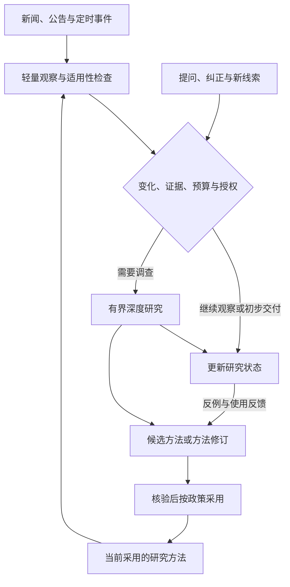

# Stock Insight：设计意图审阅

**v0.3｜2026-11-22｜设计意图、接口接入与 Codex 开工说明**

配套文件：`02-architecture-codex-technical-zh.md`、`03-interface-reuse-catalog.md`。本文件帮助你判断交给 Codex 的问题是否准确；具体架构由 Codex 调查、比较和提出。

**本版新增：** 第 10 节给出已研究的接口接入方向，第 11 节明确 Codex 必须产出的实际架构审阅文件，第 12 节给出开工设置。接口事实放在独立文件中，主任务书仍保留设计空间。

## 1. 这次应当交给 Codex 的问题

> 怎样在现有项目上，构造一个持续运行的个人股票研究系统：日常检查尽量便宜，遇到重要变化再深入研究，并把研究中有用的方法转成以后可以复用、修订和停用的观察流程？

上一版已经有事件和监控，但设计重心仍是一次调查产出一份报告。此次调整的重心是：**研究除了回答当前问题，还可能改善下一次怎样观察、什么时候值得再研究。**

你的仓库并非缺少这个方向。现有 `AGENT_WORKFLOWS.md` 已经写了材料到达后只重开重要问题、维护研究议程、方法修订需要理由与反例。新设计应把这些意图落实为可运行的机制，并检查代码实际支持到了哪里。[S1]

因此，v0.1 的默认 LangChain/LangGraph 选型、预定接口契约和固定实施阶段，不再作为本次交接的设计前提。本组 v0.3 文件构成当前交接；旧版本仅作为背景。

## 2. 系统需要形成两个循环

**日常运行循环**负责监听事件、更新观察，并根据变化、资料质量、预算和授权决定继续观察、交付初步判断或深入调查。

**方法改善循环**负责从研究、提问、纠正和失败中提出更好的观察方法，判断是否适用，再按已设政策采用、修订或停用。

下面是行为关系示意，组件可以合并，也不要求建立独立服务：



没有适用方法的新事件，也必须有调查或发现入口。方法库存不能变成系统关注范围的永久边界。关键资料缺失时，合理动作可能是补采、等待或报告缺口，并非一律启动更大的模型。

## 3. 八项具体职责：让你能审阅 component

这些是候选职责，允许 Codex 合并、重命名或用更好的方式覆盖；表格不指定八个服务、类或数据库。

| Component | 应解释清楚的职责 | 主要产物 |
| --- | --- | --- |
| **事件采集与来源状态** | 接收新闻、公告、日历和必要行情；识别重复、修订、延迟与采集失败 | 新事件、来源版本、覆盖与缺口 |
| **持续研究状态** | 保留关注对象、已知事实、假设、反证、未决问题和用户决策背景 | 可接续的研究状态及历史 |
| **方法与 Playbook 管理** | 从研究和专家方法中提炼候选检查方式；说明适用范围、来源、采用情况和失效条件 | 可复用的方法及修订记录 |
| **轻量监测执行** | 获取必要的新数据，复用仍有效的背景和计算，运行规则、简单算法或有界 prompt | 观察更新、有限初判、异常或无法判断 |
| **调度与策略控制** | 综合事件、重要性、证据完整度、时限、预算和预授权；合并重复工作 | 继续、通知、深入、等待或请求决定 |
| **深度研究 Worker** | 处理开放问题、重要变化、反证和旧方法覆盖不到的情况；动态选择专家工具 | 有证据的结论、缺口、候选方法改进 |
| **交付与交互** | 交付变化和修订，解释为什么提醒；接收追问、纠正和关注调整 | 简报、解释、反馈和新的研究线索 |
| **评估与修订** | 检查漏报、误升级、证据、成本、方法适用性和恢复表现 | 可支持继续采用、修改或停用的依据 |

个人项目可以在现有单机应用、现有数据库和少量 worker 内完成这些职责。是否需要额外进程，由实际依赖和可靠性需要决定。

## 4. “下次不用全套重跑”有三种不同含义

| 方式 | 真正复用的内容 | 需要重新判断的部分 |
| --- | --- | --- |
| **结果缓存** | 同一输入和版本下已经得到的结果，例如旧公告解析 | 输入、来源版本、时间范围是否仍有效 |
| **方法复用** | 如何提问、取哪些数据、比较什么、调用哪些专业工具 | 新事件的数据，以及方法是否仍适用 |
| **便宜筛选** | 用较少输入、较简单算法或较短 prompt 得到有限初判 | 是否漏掉重要变化，何时应补充或深入 |

你的主要需求是后两种。只增加聊天记忆、RAG 或结果缓存，覆盖不了这个目标。

一个方法最少应能解释：观察什么、为何相关、何时适用、怎样便宜检查、什么情况下升级或失效，以及凭什么继续使用。**这些是要回答的问题，不是现在锁定的 schema。**

方法可以先表现为已有工具、检查条件和研究说明的组合。是否需要结构化配置、受控代码或混合表示，应由 Codex 比较；没有理由一开始就自建通用 workflow 平台。

## 5. 用“财报不错，股价却不一定涨”检验设计

以下是行为例子，不构成对某只股票的判断。

**第一次研究。** 系统先明确“不错”是增长、超过公司指引，还是超过公告前的市场预期；明确价格观察窗口，再检查指引、关键业务指标和其他解释。研究保留事实、假设、反证与缺口。

**形成候选方法。** 研究可能提出：下一次先看同口径的实际与可用预期、指引变化、关键 KPI 和明确时间窗口的价格反应；出现矛盾或新情况时再深入。它得到的是一种检查方法，尚不能认定“财报超预期后会下跌”是一条可靠规律。

**下一次财报。** 监测自动获取本次必要的新数据，沿用仍适用的检查方法。旧背景可以复用，新财报数字必须更新。没有公告前预期快照时，不能把事后取得的当前预期当成当时预期。

**按条件推进。** 信息充分且没有重要变化时，可以安静记录，或按偏好给出有限初判；出现指引与业绩背离、关键假设变化、异常价格反应或方法不适用时，进入深化策略。部分问题只需补一个工具或重算一部分，无需默认全量调查。

**授权与反馈。** 已经允许自动研究的范围内继续执行；超过已设费用或范围才请求决定。新研究发现旧方法忽略了关键因素，就提出修订，并保留原因和适用范围。是否自动采用修订，也由预先设置的政策决定。

这里的“逐渐完善”首先是积累和改进研究程序。它不自动等于模型训练、获得稳定预测优势，或允许运行中的 agent 任意改写项目代码。

## 6. Harness 到底能分担什么

我的建议是把**可确定的运行工作交给程序，把开放问题留给研究判断，把专业计算交给经过核实的工具**：

| 工作 | 优先承担者 | 省下什么，仍需注意什么 |
| --- | --- | --- |
| 时间与日历、已知标识映射、精确去重、版本与新鲜度检查 | Harness / 普通代码 | 省去反复让模型决定是否到时间、是否重复；语义含糊的事件仍需判断 |
| 增量获取、可复用计算、固定比较、缓存失效 | Harness + 专业工具 | 识别新信息影响的观察与结论，只更新相关部分；同口径与输入有效性必须成立 |
| 超时、重试、恢复、预算、预授权、交付记录 | Harness | 减少模型充当任务管理员的工作；移除框架后这些职责仍存在 |
| 提问澄清、解释反证、识别陌生情境、设计下一轮调查 | LLM | 保留研究自由；需要可追溯证据和工作边界 |
| 新闻相关性、粗筛与初步解释 | 由 Codex 比较规则、统计方法和 LLM | 选型取决于漏报、延迟和实际成本，不能仅按 token 数判断 |

这轮方案以不引入 LangChain/LangGraph 为方向。理由是先用现有代码和必要部件满足需求；我们还没有证据证明需要它们。也不能仅凭框架名称判定所有用法都臃肿，更不能因此重造整套通用底座。

## 7. Eval 要审查“是否值得这样运行”

最重要的评估对象增加了：**轻量路径是否在节省工作时，仍保留足够的信息覆盖和研究质量。**

- **覆盖与路由：** 应发现的事件是否到达，重要变化是否被漏过，发现和升级延迟多久。要抽查被跳过的事件，否则无法发现粗筛的漏报。
- **研究与证据：** 数字、来源、时间和结论是否对应；初判的表述是否超出证据；缺口是否被准确暴露。
- **方法有效性：** 同一方法换到新事件是否适用，何时应退出；修订后是否减少重复工作，同时引入了什么新错误。
- **真实代价：** 模型、数据、工具、等待和个人维护的总成本。深度研究可用作对照，但它自身也可能错，不能自动视为标准答案。

若要评估预测能力，应另有明确预测时点、结果定义和后续检验。报告写得好、用户满意、一次股价方向碰巧正确，是三类不同证据。历史回放必须限制到当时可获得的信息；需要警惕模型可能记得历史结局。

## 8. 外部项目在这次设计里的位置

以下是已找到的具体线索，完整入口见技术版。它们帮助 Codex 调查，不自动成为依赖清单。

| 来源 | 最值得借的部分 | 对个人项目的使用方式 |
| --- | --- | --- |
| **现有 Stock Insight** | 研究状态、时间语义、监控、任务和交付基础；文档已有方法修订意图 | 优先核实并延伸，处理现有路径间的断点 |
| **DSA / Dexter** | MCP 分析接口、上下文组装、工具执行、结果压缩和轨迹诊断 | 按能力接入或少量适配；先检查隐藏调用成本、证据和耦合 |
| **Pi** | 正式 agent/session/tool SDK | 运行器候选；增加另一套语言运行时的收益需要解释 |
| **Fiscal.ai** | 专业数据、分析工具与专家方法说明 | 通过有权限的接口复用；研究口径仍需核对 [S4] |
| **Samaya** | 报告转工作流、按事件触发研究、持续追踪 thesis | 借公开产品行为；内部实现与生产代码并未公开 [S2] |
| **QuantConnect / LEAN** | 轻量事件处理、定时工作分离、判断到期与提前失效 | 借运行原则，不搬入整个量化交易引擎 [S3] |
| **FrontierFinance** | 研究报告 rubric / grader | 可选复用评分组件；本项目的漏报和方法生命周期评估仍需补充 |

TradingAgents、ValueCell、AlphaSense 保留为局部机制或产品对照，不需要把所有项目拼进运行链。复用数量不是目标；减少自己的维护工作，同时守住本项目的研究语义，才有价值。

## 9. 怎样判断这份 prompt 会引导出你要的东西

固定在任务书里的应是用途和可观察行为；组件边界、存储格式、具体算法、模型选择和改造顺序留给 Codex 论证。OpenAI 当前指南也建议说明所需结果与审阅标准，并给常规实现决策留出空间。[S5]

你审阅时可以围绕四个问题：

1. **没有新聊天时，系统能否继续推进已授权的研究工作？**
2. **一次有用研究之后，下次是否可能少做重复工作，同时知道什么必须更新？**
3. **便宜方法失效或漏报时，系统能否发现，并据此改进？**
4. **Codex 是否仍需要亲自判断怎样实现，而不是照着本文施工？**

技术版要求 Codex 给出推荐方向、有实质差异的备选、组件职责、现有代码映射、具体复用来源和关键不确定性。本任务书保留设计空间，但 Codex 的最终产出必须形成具体方案，不能继续停留在这些需求和候选组件上。

## 10. 现成接口：这次已经研究到怎样接

`03-interface-reuse-catalog.md` 已核实官方 API、OpenAPI 和 SDK，包括具体路由、参数、鉴权、时间语义、分页或增量方式，以及接入当前代码的位置。数据采集与专业数据服务优先复用，固定取数无需每次调用 LLM；MCP 也可以由普通程序调用。

建议组合是：**延伸现有 SEC 和发行人公告入口，以 Fiscal 接公司新闻、财报日历和研究数据；专用新闻或盘前盘后行情不足时再评估 Alpaca，Finnhub 保留为替代。** 不要求同时部署所有供应商。保留已有 Fed/BLS 等宏观来源，不能用公司财报日历替代全部事件雷达。

本项目需要掌握的是薄适配：身份与时间、去重和修订、断线补采、配额、覆盖记录，以及新信息如何进入研究。供应商已经提供的采集、专业数据与工具能力，没有必要重写。

这里有三个实际边界：

- 当前仓库的 Fiscal 代码只有公司资料预检和 MCP 工具目录发现，尚不能写成新闻、行情和财报日历已经全部接通。
- 已查阅的 Fiscal 免费文档是限定公司与 250 次/日；轮询频率必须与关注范围匹配。接口存在不等于当前账号拥有每种数据。
- 原始公告、新闻摘要、当前估计与公告前预期是不同材料。目录特别标出了这些语义，避免“接通接口”之后研究仍用错数据。

本次完成的是公开接口与代码核查，未进行带用户凭据的数据调用。Codex 直接使用这些研究成果，仅补实际账户、当前 checkout 和发生变化的协议检查，无需从头重做供应商调研。

## 11. Codex 完成后，必须再给你一份具体架构审阅文件

本轮 Codex 的交付路径约定为：

`docs/architecture-review-v0.3/HARNESS_ARCHITECTURE_REVIEW.md`

这份文件由 Codex 根据它最终推荐的方案编写。你将能审阅：

- 实际采用哪些组件、模块和进程，分别对应现有代码哪里，哪些需要修改或新增。
- Harness 在什么条件下调用模型，怎样运行工具循环，什么时候停止；包含简短伪代码或时序图。
- 一次模型调用会看到什么上下文，工具怎样被选择，证据怎样保存，怎样避免重复调用。
- 新闻、日历、行情等最终选哪家、哪个 endpoint 或 SDK，怎样接入并记录实际覆盖。
- 方法怎样采用、运行、局部更新、失效与修订；授权与预算怎样影响后续工作。
- 来源失败、重复事件、超时、重启和通知失败怎样处理。
- 安静监测与财报条件研究的完整例子，以及如何测量漏报、费用和研究质量。

文件必须区分**现有实现、拟议设计、做过的验证和未核实假设**。这轮“开工”沿用当前设计审阅范围：Codex 完成具体设计并写好该文件；后续进入实现时，再把它更新为实际实现状态。不能仅把本任务书换一个标题交回来。

## 12. 开工设置

| 项目 | 建议 |
| --- | --- |
| 模型 | `GPT-6.2 Astra`，以当前客户端实际可见型号为准 |
| Thinking effort | `Extra High / xhigh` |
| 对话 | 在同一实际仓库开新对话；通过本组文件和当前代码恢复上下文 |
| 并行调查 | 允许 Codex 对独立问题使用子代理，再由主代理整合与评审 |
| 本轮终点 | 写出具体 `HARNESS_ARCHITECTURE_REVIEW.md` 并向你交付 |

Astra 与 Extra High 适合这次跨代码、接口和长期运行机制的开放设计判断；这是本项目的建议。官方把 Ultra 用于特别复杂且适合拆分的大任务，本轮不必默认最高档。[S6]

新对话的推荐是为了避免旧实施方向继续影响本轮设计任务。CLI 的 `/new` 可以在同一会话环境开新聊天；无需因为换聊天而复制项目。模型名称写进 prompt 本身不会更改实际模型设置。[S7]

把这三份文件放到仓库的 `docs/stock-insight-design-guide-v0.3/`，选择模型与 effort 后，发送：

```text
请读取 docs/stock-insight-design-guide-v0.3/02-architecture-codex-technical-zh.md，
结合 01 的设计意图和 03 的接口研究，完成这次具体架构设计。
请交付 docs/architecture-review-v0.3/HARNESS_ARCHITECTURE_REVIEW.md。
按任务书调查、比较并作出推荐，不要只重复需求或交回一份待研究清单。
```

该模型设置用于这次开发/设计会话，不自动成为 Stock Insight 常驻运行的模型和费用配置。

## 来源

- [S1] [Stock Insight：AGENT_WORKFLOWS，审查快照](https://github.com/Freedom-Jack/ai-stock-insight/blob/ad86b95b7e71cdb81554a0684bbc43811de01a84/docs/stock-insight-v3/design/AGENT_WORKFLOWS.md)。本次已读取本地 checkout，重点为第 5、9、10、11 节；未来应以实际 checkout 为准。
- [S2] [Samaya Research Platform](https://samaya.ai/product/platform)。支持对公开能力的描述，不支持推断其内部架构。
- [S3] [QuantConnect：Algorithm Performance](https://www.quantconnect.com/docs/v2/writing-algorithms/key-concepts/algorithm-performance)；[Insight Manager](https://www.quantconnect.com/docs/v2/writing-algorithms/algorithm-framework/insight-manager)。将其运行和生命周期思想用于本项目，是本文件的设计建议。
- [S4] [Fiscal.ai：MCP Skills](https://docs.fiscal.ai/docs/guides/mcp-skills)。
- [S5] [OpenAI：Prompting GPT-6.2 in Codex](https://learn.chatgpt.com/guides/prompting-gpt-6-2-astra)；[Prompting](https://learn.chatgpt.com/docs/prompting)。本文不宣称存在唯一最佳 prompt 或保证模型产出质量。
- [S6] [OpenAI：Model selection](https://learn.chatgpt.com/docs/model-selection)；[GPT-6.2 prompting 指南](https://learn.chatgpt.com/guides/prompting-gpt-6-2-astra)。
- [S7] [OpenAI：CLI Developer commands](https://learn.chatgpt.com/docs/developer-commands?surface=cli)。
- 第 10 节的供应商事实、具体协议与现有代码依据，逐项列在配套 `03-interface-reuse-catalog.md`，核查日为 2026-11-22。
