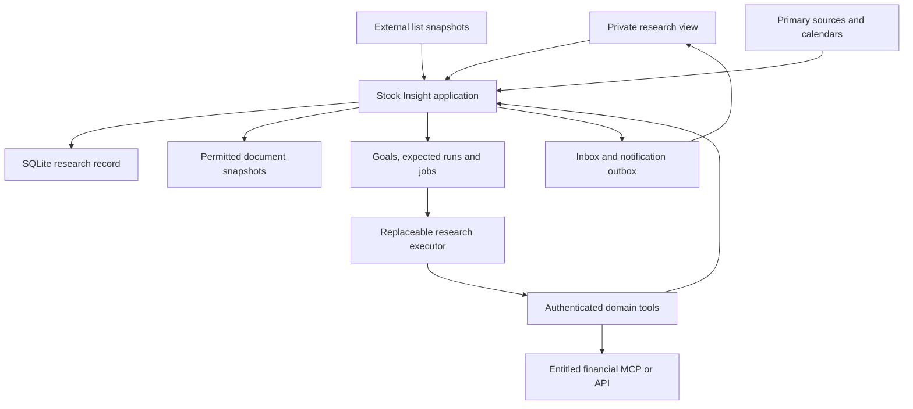
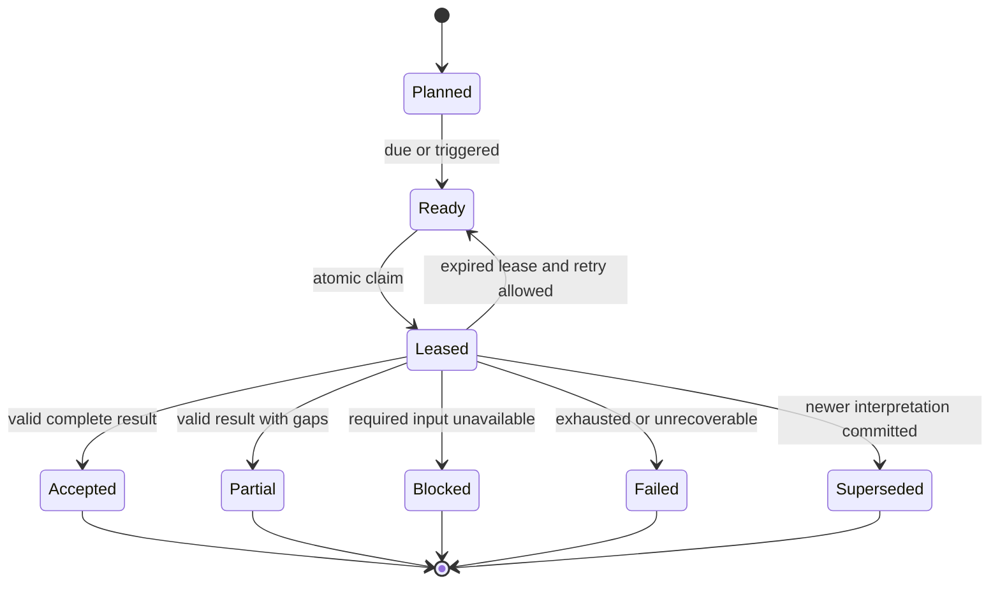

# Architecture

Status: Version 3.1 normative design. Read with [contracts](DATA_AND_TOOL_CONTRACTS.md) and [deployment profiles](LAPTOP_OPERATIONS.md).

## 1. Form and ownership

Use one domain application and one replaceable reasoning executor. Run the same application locally for trial and on one server for continuous operation. The domain application owns durable facts about work and research; external providers initially own selected watchlist membership. The executor owns the investigative plan for a particular assignment. Existing financial providers supply data and, where useful, their own summaries or analytical outputs.

The coding agent implementing this repository is a development tool. The runtime research agent receives scoped research work and cannot change the application's code, dependencies, credentials or adopted user preferences merely by deciding that a new tool would be useful.

Logical boxes are module responsibilities, not microservices. A network/provider outage must not prevent reading existing research or seeing the missing work.

## 2. Selected implementation stack

| Component | Initial choice | Reason / limit |
|---|---|---|
| Runtime | Python 3.11+ compatible with current repository; pin a tested minor version and dependency lock during implementation | Preserves current code and deployment skills |
| HTTP/UI | FastAPI, Pydantic models and Jinja templates; modest progressive enhancement | Typed tools and a useful local interface without a separate front-end platform |
| Storage | Standard-library SQLite, explicit repositories and numbered transactional SQL migrations | One controlled writer; no ORM/database platform required for initial scope |
| Search | SQLite FTS5 plus entity, time, source and case filters | Add embeddings only for a demonstrated retrieval failure |
| Documents | Content-addressed files with SQL metadata and entitlement rules | Reproducible inputs without large database blobs |
| Network | One managed HTTP client with timeouts, retry policy, per-provider quotas and destination policy | Keep source-specific behavior in adapters |
| MCP | Official SDK compatible with chosen protocol version; recording client/bridge for existing servers | Reuse provider schemas; do not invent a separate wrapper service for each tool |
| Background work | Application scheduler/reconciler plus bounded async workers; SQL state is authoritative | No Redis, Celery or distributed scheduler required |
| Research executor | One local Codex CLI adapter after authentication/permission preflight | Replaceable through the job/result contract; no subscription entitlement assumed |
| Alternative executor | Outbound API adapter with explicit budget and local tool handling | A cloud-managed model does not inherently require an inbound tunnel |
| Tests | Existing unittest suite plus focused contract/recovery/integration fixtures | Retain working behavior and test meaningful failure boundaries |

These are design selections, not claims that libraries are installed or that current HEAD uses them. Confirm supported versions and official SDK contracts at construction time. Implement migration checksums and forward-only normal upgrades; take a backup before destructive schema changes. Do not migrate a user's existing store in place without a verified recovery copy.

## 3. Module responsibilities

| Proposed area | Responsibilities |
|---|---|
| `stockinsight/domain` | Stable IDs, entities/instruments, events, claims, cases, methods, briefs and schema validation |
| `stockinsight/storage` | SQL migrations, repositories, commit sequence, snapshots, FTS, export and backup |
| `stockinsight/sources` | Public filings/IR/calendars/news adapters, provider result normalization and source health |
| `stockinsight/watchlists` | Manual/file snapshot parsing, selected provider read adapters, identity resolution and inbound membership reconciliation; authority separate from transport |
| `stockinsight/capabilities` | Provider configuration, discovery, schemas, entitlement/probe state, quotas and recorded calls |
| `stockinsight/research` | Context selection, agenda, methods, claim review and result acceptance |
| `stockinsight/execution` | Expected runs, jobs, leases, host adapter, retry, catch-up and separate outboxes |
| `stockinsight/analytics` | Deterministic financial comparisons, returns, sensitivity and historical comparisons |
| `stockinsight/api` | Authenticated domain tools, local browser routes and bounded query interface |
| `methods` | Versioned research instructions and machine-readable applicability/input/output metadata |
| `integrations` | Local executor configuration and OS launch scripts; optional later remote host adapters |

Keep old `stockwatch` behavior available during migration. Adapt its earthquake observations into the general model; do not broaden the old quake-specific types until they accidentally become an inconsistent universal schema.

## 4. End-to-end execution

1. A user question, calendar deadline, source observation or agenda item creates a case/job. Recurring goals create `ExpectedRun` rows before execution is attempted.
2. Commit the job and its dispatch-outbox entry together. Important verified source facts can also create an inbox notice immediately, labeled analysis pending.
3. The executor claims the job through a scoped tool. The service issues a lease, fencing generation, case revision, cutoff policy and context manifest.
4. The agent chooses a method and the tools needed for the question. Every service-mediated call records actual execution, coverage and returned input versions. It can add evidence without changing the case's interpreted revision.
5. Submission freezes the run's read-set. Validate references, timestamps, calculation inputs, scope, current lease and base case revision; perform targeted semantic review of material claims.
6. Commit the accepted brief, claims, dependencies, follow-up and notification-outbox entry in one short transaction. Partial results are allowed when gaps are explicit.
7. Delivery retries operate on the accepted brief. They never rerun research solely because a notification failed. A later correction creates a new revision with a linked notice.

`ExpectedRun` deadline state and notification state are separate from this job lifecycle. A result recovered after sleep can be accepted while its original expected run remains late/missed. A host saying “complete” is transport/execution evidence; only application acceptance completes the research result.

## 5. Financial-tool integration

Prefer official MCP or documented APIs. Configure providers once, list their tools, retain schema versions and map selected operations to domain capabilities such as `financials.statements`, `earnings.transcript`, `market.price_context`, `expectations.snapshot` or `events.company_calendar`.

Use a thin recording bridge rather than reimplementing each provider. It enforces configured tool/endpoint access, budgets and entitlement policy; forwards the provider's actual argument schema; records provenance; and returns a typed result envelope. Normalize only data needed for cross-provider comparisons or durable research. Keep the original permitted response or a hash/reference where retention is restricted.

The agent can inspect available capabilities and choose among them. Discovery is limited to configured/approved servers and public documentation. `tools/list` does not establish that the account can use every endpoint, that data is fresh enough, or that a result is comparable to another provider's figure. Each capability has separate discovered/configured/entitled/exercised/validated evidence. Failed access remains a gap, not an empty successful result.

Some hosted agents can call native financial connectors directly. They may be used when their observed provenance is adequate for the task and they enforce the same approved read-operation scope. Broker/account/portfolio/position/order operations and vendor workspace mutations remain unavailable. If a native path cannot enforce the required scope, disable it and use a controlled recorded capability. Preserve the actual traceability: host-reported browsing is not a fabricated service receipt. A required source check needs qualifying evidence or must remain unverified.

Provider-generated event summaries are useful navigation and background. Material claims should point to the underlying release/transcript or remain attributed to the provider summary. An LLM summary is not independent confirmation of a company's disclosure.

## 6. Research record and memory

The SQL record is canonical for structured state; permitted documents are canonical evidence inputs. Markdown methods and exportable notes are readable views and instructions, not a reason to use a directory of mutable prose as the only transactional database.

This is an intentional distinction: Markdown is the best format for this implementation handoff and for versioned methods. Jobs, timestamps, relationships, deduplication and revision-safe updates need structured storage. Export cases as Markdown plus JSON so another agent can read them without understanding a private database format.

Keep company facts, estimates, inferences, user beliefs, hypotheses and decision notes separate. Import selected chats with authors and source identity. Build compact task-specific context from current case state plus relevant history; retrieve exact passages as needed. A host's conversation memory is helpful but cannot be the only copy of a research decision.

## 7. Persistence and concurrency

Prefer WAL mode after verifying a SQLite runtime with the documented WAL-reset fix; use rollback-journal mode if that condition is not met. The dependency check and official reference are in [laptop operations](LAPTOP_OPERATIONS.md). Enable foreign keys, a busy timeout and one controlled write path. Network/model work occurs outside transactions. Snapshot persistence is staged: write temporary bytes, flush, atomically rename, then commit the database reference. A crash may leave an unreferenced file; it must not leave an accepted result pointing to a nonexistent snapshot.

Watchlist inputs have an additional boundary: validate the schema and project instrument-only fields **before any application blob, snapshot or log persistence**. Rejected inputs retain safe diagnostics only. Generic original-response retention applies only after both data-scope and entitlement checks. The user's selected source file remains their file; the application must not archive an accidentally selected portfolio report.

Each committed write receives an increasing local sequence. Preserve source and receipt timestamps separately. Idempotency keys and uniqueness constraints handle duplicates; leases and optimistic case revision checks handle competing work. These controls are needed even on one laptop because retries and resumed processes overlap.

A backup contains a consistent SQLite snapshot and all referenced permitted blobs, with a manifest. Retaining a manifest alone cannot restore documents. Rebuildable indexes can be excluded. See operations for restore, retention and later server handover.

## 8. Security boundaries proportional to this product

Bind the UI to loopback, validate Host/Origin, use a per-install local session token and CSRF protection, and avoid unauthenticated mutating GET routes. Windows-to-WSL loopback behavior must be checked on the actual configuration. Never fix a reachability problem by silently binding all interfaces.

Application/provider credentials stay outside repository, model context and ordinary logs. The runtime agent receives a short-lived assignment-scoped token. It must not obtain direct SQL, arbitrary HTTP proxy, broker, unrestricted file-system or dependency-install privileges through research tools.

A local CLI can have more ambient authority than a remote model. Pin its supported sandbox/tool configuration and verify actual enforcement. Run it under an appropriately restricted OS identity when needed to keep application secrets and data inaccessible; a separate process or prompt is not an OS boundary. A personal-user execution mode must still meet the runtime access restrictions; making scope visible is not an exemption. If required restrictions cannot be enforced, select the outbound API executor instead of claiming isolation.

Treat source documents and chat imports as untrusted evidence, not instructions. Source fetchers validate destinations and redirects, block private/metadata endpoints, limit bytes/time and parse supported formats. Financial tools use named operations rather than user-supplied arbitrary URLs. No broker credential exists in the default file-import path.

## 9. Local trial and planned continuous server

Physical deployment changes availability, not the domain model. Define two configuration profiles from the start:

| Profile | Purpose and implementation |
|---|---|
| `local_trial` | Development, testing and initial personal use. Run the application/selected worker in a foreground WSL session with a local inbox. Windows autostart, companion watchdog and toasts are optional; do not build them before the useful research loop. Preserve misses after interruption. |
| `server_single_node` | Planned 24/7 operation. Run the same release on one Linux host under supervision, with durable storage, verified worker permissions, off-host backups, an independent health observer and a configured notification route. No distributed rewrite is required. |

Recovery reconstructs expected obligations, not fictional observations. A trial label never waives credential, portfolio or tool-access boundaries. Use sanitized fixtures until those boundaries are verified for live work, or choose a supported application-tool API executor.

A cloud model can be used via outbound requests/WebSocket tool handling when the selected API supports it. A cloud assistant that independently calls a remote MCP server requires a reachable authenticated endpoint; do not assume it can use `localhost`. A public tunnel is an optional later deployment choice, not a baseline dependency.

Commission the server when continuous operation is requested: stop the old scheduler, transfer a verified backup and identifiers, rebind secrets and input routes, restore and reconcile, then enable the new scheduler. At no point should two instances dispatch the same ownership domain. SQLite remains suitable for one writer on that host; PostgreSQL and shared object storage are later concurrency decisions, not prerequisites to server operation. Keep the application listener private behind the selected authenticated access route; adding internet access is a separate deployment choice.

The user's IBKR Client Portal/Mobile list remains externally authoritative in either profile. A server can receive a manual instrument snapshot through its private UI or poll a verified provider adapter. It cannot assume access to a laptop-only file or broker session. Server uptime, financial-source health and watchlist freshness are separate status dimensions; broker authentication constraints do not disappear on a server.

## 10. Deliberately deferred complexity

Do not add a multi-agent hierarchy, vector database, graph database, streaming bus, browser automation fleet, generalized plugin marketplace or runtime self-programming unless a concrete failure warrants it. The relationship model, capability registry and executor interface leave room for these without making them initial dependencies. Broad product scope is compatible with a small deployment.
